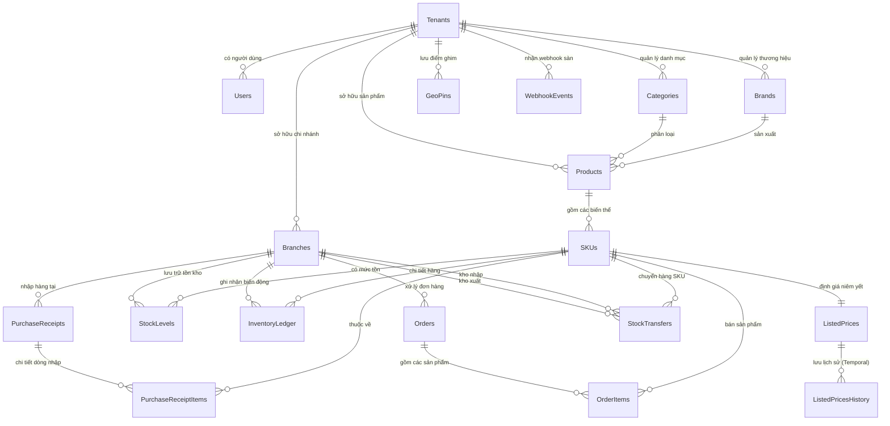

# OISM - Omnichannel Inventory and Sales Management System
### Hệ Thống Quản Lý Bán Hàng & Tồn Kho Đa Kênh

[](https://www.microsoft.com/sql-server)
[](https://dotnet.microsoft.com/)
[](https://www.docker.com/)
[](https://github.com/maicotien552006-hash/H-QTCSDL/actions)
[](https://leafletjs.com/)
[](LICENSE)

> **Đồ Án Môn Học:** Hệ Quản Trị Cơ Sở Dữ Liệu (H-QTCSDL)  
> **Repository GitHub:** [https://github.com/maicotien552006-hash/H-QTCSDL](https://github.com/maicotien552006-hash/H-QTCSDL)  
> **Kiến trúc cốt lõi:** Microsoft SQL Server 2022 Enterprise (Compatibility Level 160) + ASP.NET Core 8.0 Web API (Dapper) + Single-Page Web App (Tailwind CSS, Leaflet GIS) + Docker Compose + GitHub Actions CI/CD.

---

## 📑 MỤC LỤC
1. [Giới Thiệu Đề Tài & Bài Toán Nghiệp Vụ](#-giới-thiệu-đề-tài--bài-toán-nghiệp-vụ)
2. [Kiến Trúc Tổng Thể Hệ Thống](#-kiến-trúc-tổng-thể-hệ-thống)
3. [Thiết Kế Cấu Trúc Dữ Liệu & Mô Hình CSDL](#-thiết-kế-cấu-trúc-dữ-liệu--mô-hình-csdl)
   - [Sơ Đồ Quan Hệ Thực Thể (ERD)](#sơ-đồ-quan-hệ-thực-thể-erd)
   - [Đặc Tả Chi Tiết 14 Bảng Thực Thể](#đặc-tả-chi-tiết-14-bảng-thực-thể)
   - [Quy Trình Chuyển Kho 2 Bước (In-Transit Stock Transfer)](#quy-trình-chuyển-kho-2-bước-in-transit-stock-transfer)
4. [10 Kỹ Thuật CSDL SQL Server 2022 Đột Phá](#-10-kỹ-thuật-csdl-sql-server-2022-đột-phá)
5. [Hướng Dẫn Khởi Chạy Ứng Dụng (3 Cách)](#-hướng-dẫn-khởi-chạy-ứng-dụng-3-cách)
6. [Tài Khoản Đăng Nhập Mẫu & Phân Quyền (RBAC)](#-tài-khoản-đăng-nhập-mẫu--phân-quyền-rbac)
7. [Danh Mục REST API & Webhook TMĐT](#-danh-mục-rest-api--webhook-tmđt)
8. [Quy Trình Kiểm Thử Tự Động & CI/CD](#-quy-trình-kiểm-thử-tự-động--cicd)
9. [Kịch Bản Trình Diễn Khi Bảo Vệ Đồ Án](#-kịch-bản-trình-diễn-khi-bảo-vệ-đồ-án)
10. [Cấu Trúc Thư Mục Dự Án](#-cấu-trúc-thư-mục-dự-án)

---

## 🎯 GIỚI THIỆU ĐỀ TÀI & BÀI TOÁN NGHIỆP VỤ

Trong bối cảnh bùng nổ thương mại điện tử, các doanh nghiệp bán lẻ phải vận hành đồng thời trên nhiều kênh: **Quầy bán lẻ (POS)**, **Shopee**, **TikTok Shop**, **Lazada** và **Website/Admin**. Sự phức tạp trong quản lý kênh dẫn tới các thách thức kỹ thuật lớn:
- **Bán vượt quá tồn kho (Overselling):** Khi nhiều kênh cùng đặt 1 SKU vào thời điểm Flash Sale.
- **Xung đột & Deadlock đọc-ghi:** Thu ngân thanh toán quầy và thủ kho nhập hàng/kiểm kê cạnh tranh tài nguyên CSDL.
- **Bảo mật đa khách thuê (Multi-Tenancy):** Rò rỉ dữ liệu giữa các doanh nghiệp khi dùng chung một Database.
- **Kiểm toán bất biến (Audit Trail):** Ngăn chặn việc nhân viên tự ý sửa/xóa số liệu hàng tồn kho.
- **Giá vốn biến động:** Xác định chính xác giá vốn thực tế (COGS) theo phương pháp bình quân gia quyền.

**Hệ thống OISM (Omnichannel Inventory and Sales Management System)** được thiết kế chuyên biệt để giải quyết trọn vẹn các thách thức trên bằng cách tối ưu hóa triệt để năng lực của **Microsoft SQL Server 2022**.

---

## 🏗️ KIẾN TRÚC TỔNG THỂ HỆ THỐNG

```text
┌────────────────────────────────────────────────────────────────────────┐
│               PRESENTATION LAYER (Frontend Web Client)                 │
│  - Giao diện bán hàng POS Fast Checkout (Cảm ứng, Phím tắt F2-F9)       │
│  - Trung tâm Đơn hàng Đa kênh: Shopee, TikTok Shop, Lazada             │
│  - Bản đồ GIS số hóa mạng lưới 11 chi nhánh & Định vị GPS (Leaflet)   │
│  - Chế độ In-Memory an toàn: Hoạt động ngay cả khi không có kết nối DB│
└───────────────────────────────────┬────────────────────────────────────┘
                                    │ (HTTP REST API / JSON Payload)
                                    ▼
┌────────────────────────────────────────────────────────────────────────┐
│             APPLICATION & BUSINESS LOGIC (.NET 8 Minimal API)          │
│  - Xác thực JWT & Phân quyền RBAC (Owner, Staff, Cashier)              │
│  - Multi-Tenant Middleware: Inject SESSION_CONTEXT(N'TenantId')        │
│  - Background Service: Quét hủy đơn giữ quá hạn định kỳ                │
│  - Truy cập dữ liệu hiệu năng cao qua Dapper Micro-ORM                │
└───────────────────────────────────┬────────────────────────────────────┘
                                    │ (T-SQL Commands, TVP & Stored Procedures)
                                    ▼
┌────────────────────────────────────────────────────────────────────────┐
│           ENTERPRISE DATABASE ENGINE (SQL Server 2022 - CL 160)        │
│  1. RCSI Snapshot: Triệt tiêu hiện tượng khóa chặn đọc-ghi             │
│  2. Row-Level Security (RLS): Cô lập dữ liệu Tenant ở mức CSDL         │
│  3. Temporal Tables (System-Versioned): Lịch sử biến động giá niêm yết│
│  4. Spatial GIS Data: Hệ tọa độ WGS84 (SRID 4326), STDistance()        │
│  5. Table Partitioning: Phân vùng Sổ cái kho theo tháng                │
│  6. Append-Only Trigger: Chặn sửa/xóa, bảo toàn tính bất biến Sổ cái   │
│  7. WAC Trigger: Tự động tính giá vốn bình quân gia quyền khi nhập     │
│  8. Nonclustered Columnstore Index: Tăng tốc báo cáo doanh thu gấp 10x │
│  9. State Machine Trigger: Ép buộc luồng trạng thái đơn hàng nghiêm ngặt│
│ 10. Two-Step Stock Transfer: Chuyển kho an toàn In-Transit 2 bước      │
└────────────────────────────────────────────────────────────────────────┘
```

---

## 🗄️ THIẾT KẾ CẤU TRÚC DỮ LIỆU & MÔ HÌNH CSDL

### Sơ Đồ Quan Hệ Thực Thể (ERD)



---

### Đặc Tả Chi Tiết 14 Bảng Thực Thể

| STT | Tên Bảng | Mục Đích Nghiệp Vụ | Khóa Chính (PK) | Khóa Ngoại (FK) & Ràng Buộc (Constraints) | Tính Năng Nâng Cao Áp Dụng |
| :---: | :--- | :--- | :--- | :--- | :--- |
| **1** | `dbo.Tenants` | Cửa hàng / Doanh nghiệp thuê nền tảng | `TenantId (int)` | `Name NOT NULL, IsActive DEFAULT 1` | Bảng gốc của Multi-Tenancy |
| **2** | `dbo.Users` | Tài khoản nhân viên đăng nhập | `UserId (int)` | `TenantId -> Tenants`, `UQ(TenantId, Email)`, `CK(Role IN Owner, Staff, Cashier)` | Mã hóa BCrypt ($2a$11$) |
| **3** | `dbo.Branches` | Chi nhánh, cửa hàng, kho bãi vật lý | `BranchId (int)` | `TenantId -> Tenants` | **Spatial GIS (`geography`, SRID 4326)**, RLS |
| **4** | `dbo.GeoPins` | Điểm ghim định vị & Hub bưu cục | `PinId (int)` | `TenantId -> Tenants` | **Spatial GIS**, RLS cô lập điểm ghim |
| **5** | `dbo.Categories` | Danh mục sản phẩm (đa cấp cha-con) | `CategoryId (int)` | `ParentId -> Categories(CategoryId)` | RLS |
| **6** | `dbo.Brands` | Thương hiệu sản phẩm | `BrandId (int)` | `TenantId -> Tenants` | RLS |
| **7** | `dbo.Products` | Sản phẩm cha | `ProductId (int)` | `CategoryId`, `BrandId` | RLS |
| **8** | `dbo.SKUs` | Biến thể chi tiết (Size, Màu, Barcode) | `SKUId (int)` | `ProductId -> Products`, `UQ(TenantId, SkuCode)`, `UX(Barcode)` | RLS, Indexed Barcode EAN-13 |
| **9** | `dbo.ListedPrices` | Bảng giá niêm yết bán lẻ và bán buôn | `PriceId (int)` | `SKUId -> SKUs`, `CK(RetailPrice >= 0)`, `CK(WholesalePrice >= 0)` | **Temporal Table (System-Versioned)** |
| **10** | `dbo.StockLevels` | Mức tồn thực tế và giữ chỗ tại chi nhánh | `(BranchId, SKUId)` | `Available AS (OnHand - Reserved) PERSISTED`, `CK(NoOversell)` | **Pessimistic Locking (`UPDLOCK, ROWLOCK`)** |
| **11** | `dbo.InventoryLedger` | Sổ cái kho bất biến ghi mọi biến động | `(CreatedAt, LedgerId)` | `BranchId`, `SKUId`, `CK(Type IN IN, OUT)` | **Table Partitioning theo tháng**, **Append-Only Trigger** |
| **12** | `dbo.PurchaseReceipts` | Phiếu nhập kho từ nhà cung cấp | `ReceiptId (bigint)` | `BranchId -> Branches`, `CK(Status IN Draft, Confirmed)` | RLS |
| **13** | `dbo.PurchaseReceiptItems` | Dòng sản phẩm và đơn giá nhập kho | `ItemId (bigint)` | `ReceiptId -> PurchaseReceipts`, `SKUId -> SKUs` | **Weighted Average Cost (WAC) Trigger** |
| **14** | `dbo.Orders` | Đơn hàng hợp nhất (POS, Shopee, TikTok, Lazada) | `OrderId (bigint)` | `BranchId -> Branches`, `UQ(TenantId, OrderNo)`, `UX(ExternalOrderId)` | **State Machine Trigger**, Sequence `seq_OrderNo` |
| **15** | `dbo.OrderItems` | Chi tiết sản phẩm trong đơn hàng | `ItemId (bigint)` | `OrderId -> Orders`, `SKUId -> SKUs`, `UQ(OrderId, SKUId)` | **Nonclustered Columnstore Index (NCCI)** |
| **16** | `dbo.StockTransfers` | Phiếu điều chuyển kho 2 bước | `TransferId (bigint)` | `FromBranchId`, `ToBranchId`, `SKUId`, `CK(Status)` | **In-Transit Transfer 2 bước**, RLS |
| **17** | `dbo.WebhookEvents` | Sự kiện Webhook nhận từ các sàn TMĐT | `EventId (bigint)` | `CK(ISJSON(Payload) = 1)`, `UX(ExternalOrderId)` | **JSON Engine (`OPENJSON`)**, Idempotency |

---

### Quy Trình Chuyển Kho 2 Bước (In-Transit Stock Transfer)

Để đáp ứng chuẩn mực quản trị kho hàng doanh nghiệp và bảo toàn tính toàn vẹn dữ liệu, quy trình chuyển kho được thiết kế 2 bước độc lập:

$$\text{Bước 1: Xuất kho chuyển đi} \xrightarrow{\text{Status: InTransit}} \text{Hàng trên đường vận chuyển} \xrightarrow{\text{Xác nhận nhận hàng}} \text{Bước 2: Nhập kho đích}$$

1. **Bước 1 (`dbo.usp_CreateStockTransfer`):**
   - Khóa dòng kiểm tra tồn khả dụng tại Kho A: $\text{Available}_A \ge \text{Quantity}$.
   - Trừ $\text{OnHand}_A$, ghi bút toán Sổ cái OUT (`TxnType='Transfer'`, `ReferenceType='TransferOut'`).
   - Khởi tạo phiếu chuyển trong `dbo.StockTransfers` ở trạng thái **`InTransit`**. Hàng không nằm ở bất kỳ kho nào (tránh bị bán âm).
2. **Bước 2 (`dbo.usp_CompleteStockTransfer`):**
   - Khi thủ kho B kiểm đếm và bấm "Xác nhận nhận hàng".
   - Tăng $\text{OnHand}_B$, ghi bút toán Sổ cái IN (`TxnType='Transfer'`, `ReferenceType='TransferIn'`).
   - Cập nhật phiếu chuyển sang trạng thái **`Completed`**.

---

## 🛡️ 10 KỸ THUẬT CSDL SQL SERVER 2022 ĐỘT PHÁ

| STT | Tính Năng SQL Server 2022 | Đối Tượng Triển Khai | Giá Trị & Mục Đích Nghiệp Vụ |
| :---: | :--- | :--- | :--- |
| **1** | **RCSI (Read Committed Snapshot Isolation)** | `ALTER DATABASE OISM SET READ_COMMITTED_SNAPSHOT ON` | Đọc dữ liệu từ phiên bản Snapshot trong `tempdb`. Thu ngân truy vấn kiểm tra tồn kho tại POS không bao giờ bị chặn (blocking) bởi thủ kho đang nhập hàng ngàn dòng sản phẩm. Triệt tiêu Deadlock đọc-ghi. |
| **2** | **Row-Level Security (RLS)** | `sec.fn_TenantPredicate`, `sec.TenantIsolationPolicy` | Bảo mật cô lập dữ liệu tuyệt đối giữa các cửa hàng ở tầng Database Engine. Dù câu lệnh `SELECT * FROM dbo.Products` không có mệnh đề `WHERE TenantId = ...`, Database vẫn tự lọc chỉ hiển thị dữ liệu của Tenant hiện tại. |
| **3** | **Temporal Tables (System-Versioned)** | `dbo.ListedPrices` & `dbo.ListedPricesHistory` | Tự động ghi nhận lịch sử biến động giá bán theo thời gian chuẩn ISO (`PERIOD FOR SYSTEM_TIME`) mà không cần lập trình Trigger. Dễ dàng truy vấn giá bán tại bất kỳ thời điểm nào trong quá khứ (`FOR SYSTEM_TIME AS OF`). |
| **4** | **Spatial GIS Data (SRID 4326)** | `dbo.Branches.GeoLocation` (`geography`), `Location.STDistance()` | Sử dụng chuẩn địa lý WGS84 lưu trữ tọa độ kinh độ/vĩ độ chi nhánh. Tự động tính toán khoảng cách thực tế giữa khách hàng và các chi nhánh để gợi ý điểm giao hàng gần nhất và vẽ bản đồ Leaflet. |
| **5** | **Table Partitioning (Phân Vùng Bảng)** | `pf_Ledger_Monthly`, `ps_Ledger_Monthly` trên `dbo.InventoryLedger` | Phân mảnh Sổ cái kho thành các phân vùng độc lập theo từng tháng. Cho phép truy vấn kiểm toán, bảo trì chỉ mục và lưu trữ dữ liệu lịch sử hàng triệu dòng mà không làm giảm tốc độ hệ thống. |
| **6** | **Append-Only Trigger** | `trg_InventoryLedger_AppendOnly` trên `dbo.InventoryLedger` | Ngăn chặn tuyệt đối mọi hành vi sửa (`UPDATE`) hoặc xóa (`DELETE`) trên bảng Sổ cái kho. Mọi thay đổi bắt buộc phải thông qua bút toán đảo/điều chỉnh (`Compensating Entry`), đảm bảo chuẩn mực kế toán kiểm toán. |
| **7** | **Weighted Average Cost (WAC) Trigger** | `trg_PurchaseReceiptItems_WeightedAvgCost` trên `PurchaseReceiptItems` | Tự động tính lại Giá vốn bình quân gia quyền của SKU ngay khi thủ kho nạp phiếu nhập: $\text{Cost}_{\text{mới}} = \frac{\text{Tồn cũ} \times \text{Giá cũ} + \text{Nhập mới} \times \text{Giá nhập}}{\text{Tồn cũ} + \text{Nhập mới}}$. |
| **8** | **Nonclustered Columnstore Index (NCCI)** | `NCCI_OrderItems_Analytics` trên `dbo.OrderItems` | Nén cột dữ liệu phân tích với tỉ lệ nén cao, áp dụng cơ chế Batch Execution Mode giúp tăng tốc độ xử lý các báo cáo doanh thu, giá vốn và lãi gộp đa kênh nhanh gấp 10-100 lần so với B-Tree truyền thống. |
| **9** | **Pessimistic Locking & Anti-Oversell** | `WITH (UPDLOCK, ROWLOCK) + OPTION (FORCE ORDER)` | Sử dụng khóa độc quyền dòng ngay khi đọc giỏ hàng trong `dbo.usp_ReserveOrder`, đảm bảo trong sự kiện Flash Sale với hàng trăm request đồng thời, chỉ những đơn còn đủ tồn khả dụng mới được giữ chỗ. |
| **10** | **State Machine Trigger** | `trg_Orders_StateMachine` trên `dbo.Orders` | Kiểm soát nghiêm ngặt vòng đời đơn hàng: chỉ cho phép chuyển từ $\text{Draft} \to \text{Reserved} \to \text{Confirmed} \to \text{Completed}$, hoặc hủy về $\text{Cancelled}$. Chặn đứng mọi hành vi nhảy cóc trạng thái trái phép. |

---

## 🚀 HƯỚNG DẪN KHỞI CHẠY ỨNG DỤNG (3 CÁCH)

### Cách 1: Khởi Chạy Bằng Docker & Docker Compose (Khuyên dùng - 1 Click)
Toàn bộ môi trường SQL Server 2022, Seeder CSDL, Backend .NET 8 và Web POS Nginx đã được đóng gói hoàn chỉnh:
1. Đảm bảo máy tính đã cài đặt và đang bật **Docker Desktop**.
2. Nhấp đúp vào tệp **`docker-start.bat`** tại thư mục gốc dự án (hoặc mở Terminal chạy):
   ```bash
   docker compose up -d --build
   ```
3. Chờ 15-20 giây để Database Engine khởi động và tự động chạy Seeder nạp toàn bộ cấu trúc dữ liệu và tài khoản.
4. Truy cập hệ thống:
   - **Giao diện Web POS & Dashboard:** [http://localhost:8080](http://localhost:8080)
   - **Backend API Health Check:** [http://localhost:5000/api/health](http://localhost:5000/api/health)
   - **Kết nối SSMS vào Docker:** `localhost,1433` *(User: `sa` | Password: `Oism2026@StrongPassword!`)*

---

### Cách 2: Khởi Chạy Trực Tiếp Qua SSMS 2022 & Backend Cục Bộ
Dành cho quá trình làm việc, debug truy vấn trực tiếp trên Microsoft SQL Server Management Studio:
1. Mở **SSMS 2022**, mở tệp **`database/SQLQuery1.sql`** và nhấn **F5 (Execute)** để khởi tạo Database `OISM`, các bảng, trigger, thủ tục và nạp đầy đủ dữ liệu mẫu.
2. Nhấp đúp vào tệp **`start.bat`**, chọn **[1]** để khởi động Backend API .NET 8 và tự động mở Web App.
3. Mọi thao tác tạo đơn, xuất nhập kho, chuyển kho trên Web sẽ được ghi nhận trực tiếp vào SSMS theo thời gian thực!

---

### Cách 3: Chạy Độc Lập Giả Lập In-Memory (Trực tiếp trên Trình duyệt)
Dành cho trường hợp máy tính chấm thi không có sẵn Docker hay SQL Server:
- Nhấp đúp mở trực tiếp tệp **`frontend/index.html`** bằng trình duyệt bất kỳ (Chrome, Edge, Firefox).
- Hệ thống tự động kích hoạt **In-Memory Mock Engine** tích hợp sẵn đầy đủ dữ liệu mẫu, cho phép demo mượt mà 100% tính năng POS, bản đồ GPS và mô phỏng Webhook.

---

## 🔑 TÀI KHOẢN ĐĂNG NHẬP MẪU & PHÂN QUYỀN (RBAC)

Tất cả tài khoản mẫu đều sử dụng mật khẩu mặc định: **`123456`** *(Đã được băm an toàn bằng thuật toán BCrypt $2a$11$)*:

| Doanh Nghiệp (Tenant) | Email Đăng Nhập | Mật Khẩu | Vai Trò (Role) | Phạm Vi Quyền Hạn |
| :--- | :--- | :---: | :---: | :--- |
| **Cửa hàng Thời trang Minh Anh** (Tenant 1) | `owner@minhanh.vn` | `123456` | **Owner** | Toàn quyền quản trị cửa hàng, xem báo cáo doanh thu & lợi nhuận gộp |
| **Cửa hàng Thời trang Minh Anh** (Tenant 1) | `kho@minhanh.vn` | `123456` | **Staff** | Quản lý kho, nhập hàng, kiểm kê, tạo phiếu chuyển kho |
| **Cửa hàng Thời trang Minh Anh** (Tenant 1) | `thungan@minhanh.vn` | `123456` | **Cashier** | Quầy bán lẻ POS Fast Checkout, in hóa đơn thanh toán |
| **Cửa hàng Nông sản Hữu cơ Xanh** (Tenant 2) | `owner@nongsanxanh.vn` | `123456` | **Owner** | Toàn quyền quản trị Tenant 2 (Chứng minh cô lập RLS) |
| **Cửa hàng Nông sản Hữu cơ Xanh** (Tenant 2) | `thukho@nongsanxanh.vn` | `123456` | **Staff** | Thủ kho Tenant 2 |

---

## 🔌 DANH MỤC REST API & WEBHOOK TMĐT

| Phương Thức | Endpoint | Chức Năng | Mô Tả Tham Số Chính |
| :---: | :--- | :--- | :--- |
| `POST` | `/api/auth/login` | Đăng nhập hệ thống | `Email`, `Password` $\to$ Cấp JWT Token (TenantId, Role) |
| `POST` | `/api/auth/register` | Đăng ký cửa hàng (Tenant) mới | `StoreName`, `BranchName`, `FullName`, `Email`, `Password` |
| `GET` | `/api/branches` | Lấy danh sách chi nhánh | `tenantId` $\to$ Danh sách kèm tọa độ GPS |
| `POST` | `/api/branches` | Thêm chi nhánh mới | `TenantId`, `Name`, `Address`, `Latitude`, `Longitude` |
| `GET` | `/api/geopins` | Lấy các điểm ghim bản đồ GIS | `tenantId` $\to$ Danh sách Hub, bưu cục |
| `POST` | `/api/geopins` | Tạo điểm ghim bản đồ mới | `TenantId`, `Title`, `Category`, `Latitude`, `Longitude` |
| `GET` | `/api/products` | Lấy sản phẩm & tồn kho | `tenantId`, `branchId` $\to$ SKU, Giá niêm yết, Tồn khả dụng |
| `POST` | `/api/checkout` | Thanh toán nhanh quầy POS | `BranchId`, `PaymentMethod`, `Items` $\to$ Atomic Checkout |
| `POST` | `/api/inventory/transfer` | Điều chuyển kho hàng 2 bước | `FromBranchId`, `ToBranchId`, `SKUId`, `Quantity` |
| `POST` | `/api/inventory/purchase` | Xác nhận nhập kho nhà cung cấp | `BranchId`, `SupplierName`, `Items` (SKUId, Qty, ImportPrice) |
| `POST` | `/api/inventory/stocktake` | Điều chỉnh cân đối kiểm kê kho | `BranchId`, `SKUId`, `CountedQty` |
| `POST` | `/api/webhook` | Tiếp nhận đơn sàn TMĐT | `BranchId`, `Channel` (Shopee/TikTok/Lazada), `Payload` (JSON) |
| `GET` | `/api/reports/revenue` | Báo cáo doanh thu & lợi nhuận | Lọc theo ngày, kênh bán hàng, chi nhánh (NCCI) |
| `GET` | `/api/reports/slow-moving` | Báo cáo hàng bán chậm (> 30 ngày) | Phân tích hàng tồn không có biến động xuất |

---

## 🔄 QUY TRÌNH KIỂM THỬ TỰ ĐỘNG & CI/CD

Dự án thiết lập luồng tích hợp và triển khai liên tục tự động (**GitHub Actions CI/CD**) tại `.github/workflows/ci-cd.yml` mỗi khi có commit hoặc pull request:

```text
┌────────────────────────────────────────────────────────────────────────┐
│                   GITHUB ACTIONS CI/CD WORKFLOW PIPELINE               │
├─────────────────────────┬────────────────────────┬─────────────────────┤
│ Job 1: SQL Server 2022  │ Job 2: Backend Build   │ Job 3: Docker Build │
│ - Khởi tạo MSSQL 2022   │ - Setup .NET 8.0 SDK   │ - Build Frontend Img│
│ - Thực thi SQLQuery1    │ - Restore NuGet PKGs   │ - Build Backend Img │
│ - Chạy Test Suite T1-T6 │ - Build Release binary │ - docker compose up │
└─────────────────────────┴────────────────────────┴─────────────────────┘
```

---

## 🎤 KỊCH BẢN TRÌNH DIỄN KHI BẢO VỆ ĐỒ ÁN

Để đạt điểm số tối đa trước Hội đồng chấm thi môn Hệ Quản Trị CSDL, nhóm thực hiện kịch bản 5 bước:

1. **Bước 1 - Khởi chạy & Chứng minh Bảo mật RLS:**
   - Mở SSMS thực thi `SQLQuery1.sql`.
   - Đăng nhập `owner@minhanh.vn` (Tenant 1): Hệ thống chỉ hiện sản phẩm và chi nhánh của Minh Anh.
   - Chuyển sang tài khoản `owner@nongsanxanh.vn` (Tenant 2): Dữ liệu hoàn toàn tách biệt dù dùng chung 1 database.
2. **Bước 2 - Bán hàng POS & Bút toán Sổ cái Append-Only:**
   - Tại quầy POS, chọn sản phẩm `AO-THUN-DEN-M`, nhấn **F4** thanh toán tiền mặt.
   - Mở SSMS truy vấn `dbo.InventoryLedger`: Bút toán xuất kho (`Type='OUT', TxnType='Sale'`) được sinh tự động tức thời.
   - Thử gõ lệnh `DELETE FROM dbo.InventoryLedger` trong SSMS: Chỉ cho giảng viên thấy Trigger chặn đứng và báo lỗi 50050.
3. **Bước 3 - Kiểm thử Khóa Tương tranh & Chống Bán âm (Flash Sale):**
   - Vào Tab Mô phỏng Webhook, chọn sản phẩm `FLASH-001` (chỉ còn đúng 1 tồn kho).
   - Nhấn nút "Chạy Flash Sale 50 luồng đồng thời": Duy nhất 1 đơn thành công, 49 đơn bị từ chối an toàn, tồn khả dụng không bao giờ bị âm.
4. **Bước 4 - Bản đồ GIS Không gian & Chuyển kho 2 bước:**
   - Chuyển sang Tab Bản đồ GPS, ghim 1 điểm mới để chứng minh việc lưu trữ đối tượng `geography::Point(Lat, Lng, 4326)`.
   - Chuyển sang Tab Chuyển kho, tạo phiếu chuyển kho từ Thủ Đức về Quận 1: Minh họa trạng thái `InTransit` và hoàn tất chuyển kho.
5. **Bước 5 - Temporal Table & Báo cáo Columnstore Index:**
   - Sửa giá bán lẻ của một sản phẩm, sau đó truy vấn `dbo.ListedPricesHistory` để chứng minh SQL Server tự động lưu lịch sử thay đổi giá.
   - Mở tab Báo cáo doanh thu: Chứng minh Nonclustered Columnstore Index tính toán tức thì Doanh thu, Giá vốn và Lãi gộp.

---

## 📁 CẤU TRÚC THƯ MỤC DỰ ÁN

```text
H-QTCSDL/
├── .github/
│   └── workflows/
│       └── ci-cd.yml                # Quy trình kiểm thử CI/CD tự động trên GitHub Actions
├── backend/                         # Backend Web API (ASP.NET Core 8.0 Minimal API + Dapper)
│   ├── Properties/
│   │   └── launchSettings.json
│   ├── appsettings.json             # Chuỗi kết nối SQL Server 2022
│   ├── backend.csproj               # Cấu hình dự án C# & NuGet dependencies
│   ├── Dockerfile                   # Dockerfile đóng gói Backend API
│   └── Program.cs                   # Mã nguồn REST API & RLS Tenant Session Context
├── database/                        # Toàn bộ kịch bản Cơ sở dữ liệu SQL Server 2022
│   ├── SQLQuery1.sql                # Master Database Script (DDL, RLS, Triggers, Procs, Seed)
│   ├── OISM_Spatial_GPS_Demo.sql    # Kịch bản demo dữ liệu không gian Spatial GIS (SRID 4326)
│   ├── OISM_User_Accounts.sql       # Kịch bản quản lý tài khoản & mã hóa BCrypt
│   └── SQLFile1.sql                 # Kịch bản truy vấn mẫu kiểm thử RLS Context
├── docs/                            # Hồ sơ & Tài liệu kỹ thuật đồ án
│   ├── BAO_CAO_CAC_YEU_CAU_CON_THIEU_OISM.md   # Báo cáo đối soát yêu cầu đề cương
│   └── BAO_CAO_CAC_YEU_CAU_CON_THIEU_OISM.docx # Phiên bản Word chính thức
├── frontend/                        # Giao diện Web POS & Dashboard đa kênh
│   ├── index.html                   # Single-Page Web App (Dual-mode In-Memory & Live API)
│   ├── nginx.conf                   # Cấu hình Reverse Proxy Nginx
│   ├── Dockerfile                   # Dockerfile đóng gói Frontend Web Server
│   └── success.mp3                  # Hiệu ứng âm thanh thông báo
├── scripts/
│   └── init-db.sh                   # Script tự động khởi tạo CSDL trong Docker
├── docker-compose.yml               # File điều phối Docker (MSSQL 2022, Seeder, API, Frontend)
├── docker-start.bat                 # 1-Click khởi động toàn bộ hệ thống bằng Docker
├── start.bat                        # Khởi động Backend .NET cục bộ kết nối SSMS
├── push_to_github.bat               # Script đồng bộ & đẩy toàn bộ mã nguồn lên GitHub
├── .dockerignore                    # Danh sách loại trừ khi build Docker
├── .gitignore                       # Danh sách loại trừ của Git
└── README.md                        # Báo cáo và tài liệu hướng dẫn kỹ thuật chi tiết
```

---

## 👥 THÀNH VIÊN NHÓM THỰC HIỆN
- **Đề tài:** Hệ Thống Quản Lý Bán Hàng & Tồn Kho Đa Kênh (OISM)
- **Môn học:** Hệ Quản Trị Cơ Sở Dữ Liệu (H-QTCSDL)
- **Giảng viên hướng dẫn:** Bộ môn Hệ Thống Thông Tin / Khoa CNTT
- **GitHub:** [@maicotien552006-hash](https://github.com/maicotien552006-hash)

---
*Bản quyền tài liệu và mã nguồn thuộc về Nhóm dự án OISM - H-QTCSDL 2026.*
